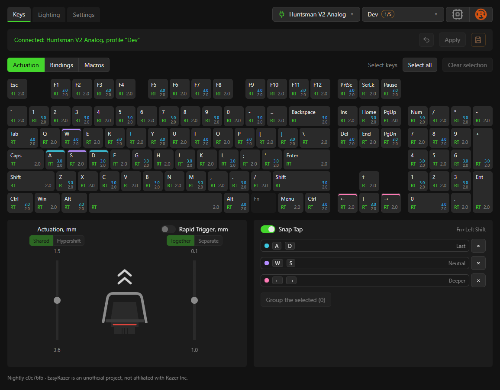

<p align="center"></p>

<h1 align="center">EasyRazer</h1>

<p align="center">
  Лёгкая замена Razer Synapse для аналоговых клавиатур Razer на Windows.
</p>

<p align="center">
  <a href="https://github.com/janeblower/easyrazer/releases/latest"></a>
  <a href="https://github.com/janeblower/easyrazer/actions/workflows/release.yml"></a>
  <a href="https://github.com/janeblower/easyrazer/releases"></a>
  
  <a href="../../LICENSE"></a>
</p>

<p align="center">
  <a href="https://github.com/janeblower/easyrazer/releases/latest/download/EasyRazer.exe"><b>Скачать</b></a> ·
  <a href="usage.md">Руководство</a> ·
  <a href="../../README.md">English</a>
</p>



> [!NOTE]
> Неофициальный проект, не связан с Razer Inc.

## Зачем

- **Маленький.** Один `.exe` на 9 МБ и один процесс, ~31 МБ памяти в трее. Synapse 4 —
  ~1.2 ГБ на диске, 13 процессов и ~1.75 ГБ памяти.
- **Настройки живут в клавиатуре.** Точки нажатия и профили записываются в её память и
  работают без какого-либо запущенного софта.
- **Печатает прошивка, а не хост.** По умолчанию нажатия определяет сама клавиатура;
  хост подключается только там, где прошивка не умеет, — например, ради Rapid Trigger на
  V2 Analog.
- **Без сети.** Ни аккаунта, ни интернета, ни телеметрии.

Полное сравнение и обоснование: [как это устроено](how-it-works.md).

## Что умеет

**Точка нажатия**
- по каждой клавише: «Применить» — до переподключения, «Записать» — в память клавиатуры;
- Rapid Trigger по клавишам, с раздельной чувствительностью нажатия и отпускания;
- Snap Tap: группы клавиш любого размера, правило для каждой, переключение Fn+LShift.

**Клавиши**
- назначения: другая клавиша с модификаторами, кнопки мыши, медиа, отключение;
- макросы: клавиши, мышь, паузы, запись нажатий;
- слой Hypershift: действие и глубина срабатывания для каждого сочетания с Fn.

**Профили**
- сколько угодно в программе, до пяти — в памяти клавиатуры; Fn+Menu — следующий.

**Подсветка**
- встроенные эффекты с живым предпросмотром;
- своя раскладка цветов по клавишам и зонам;
- переключатель динамического освещения Windows.

**Система**
- работает из трея, запускается с Windows;
- возвращает настройки после переподключения, сна и выхода из Synapse;
- русский и английский интерфейс.

Подробно, с нюансами: [руководство пользователя](usage.md).

## Поддерживаемые клавиатуры

| Модель | Статус |
|---|---|
| Huntsman V2 Analog (`1532:0266`) | ✅ полная поддержка |
| Huntsman Mini Analog (`1532:0282`) | 🧪 как V2 Analog, без макросов; на железе не проверено |

<details>
<summary>В разработке, на железе не проверено</summary>

| Модель | VID:PID |
|---|---|
| Huntsman V3 Pro | `1532:02A6`, 8 kHz `1532:02CF` |
| Huntsman V3 Pro TKL | `1532:02A7`, 8 kHz `1532:02D0` |
| Huntsman V3 Pro Mini | `1532:02B0` |
| Huntsman V3 TKL 8KHz | `1532:02E5` |
| Huntsman Signature Edition | `1532:02D8` |
| Huntsman V3 Pro Low-profile TKL 8KHz | `1532:02E6` |

</details>

Возможности по моделям и оговорки — в [полной таблице](supported.md). Есть одна из
непроверенных моделей? Отчёты очень пригодятся.

## Установка

1. Скачайте [`EasyRazer.exe`](https://github.com/janeblower/easyrazer/releases/latest/download/EasyRazer.exe)
   из последнего релиза. Это один файл без установщика, положите его куда угодно.
2. Полностью закройте Synapse, включая значок в трее.
3. Запустите `EasyRazer.exe`.

Ночные сборки из `master` выходят пре-релизом
[`nightly`](https://github.com/janeblower/easyrazer/releases/tag/nightly).

## Частые вопросы

**Нужно ли удалять Synapse?**
Нет, но запускать их одновременно нельзя: Synapse держит клавиатуру в своём режиме и
перезаписывает настройки. Пока он запущен, EasyRazer ничего не пишет и возвращает
клавиатуру в HW.

**Должен ли EasyRazer всё время работать?**
Точки нажатия и профили, сохранённые кнопкой «Записать», живут в клавиатуре. Rapid
Trigger, Snap Tap и свою раскладку цветов считает программа, им она нужна запущенной.

**Не износится ли клавиатура?**
Изменения идут в оперативную память клавиатуры; во flash программа пишет только по явной
команде «Записать» и только изменённые клавиши. Перед первой записью за сессию — бэкап в
`%APPDATA%\EasyRazer`. Подробнее: [износ flash](how-it-works.md#износ-flash).

**Почему Rapid Trigger не работает в окнах администратора и на экране блокировки?**
Windows не пропускает туда ввод от обычных программ, поэтому, пока такое окно в фокусе,
EasyRazer отдаёт ввод прошивке. У линейки V2 Analog аппаратного Rapid Trigger нет; у
линейки V3 он там продолжает работать. Подробнее:
[окна администратора](how-it-works.md#окна-администратора-экран-блокировки-uac).

**Почему в HW диапазон точки нажатия уже?**
На линейке V2 Analog прошивка ограничивает его 1.62–3.56 мм; весь диапазон 1.5–3.6 мм —
только в режиме «Драйвер». У линейки V3 такого ограничения нет: 0.1–4.0 мм в обоих режимах.

## Сборка

Нужны Rust (MSVC), Bun и MSVC Build Tools.

```
cd app
bun install
bun tauri dev      # запуск с пересборкой при изменениях
bun tauri build    # ..\target\release\easyrazer.exe
```

Тесты (из корня репозитория): `cargo test`, фронтенд: `bun run lint` (в `app`).
Тест на реальной клавиатуре (Synapse закрыт): `cargo test -p easyrazer -- --ignored`.

## Документация

- [Руководство пользователя](usage.md) — функции, управление, ограничения.
- [Как это устроено](how-it-works.md) — сравнение с Synapse, режимы, износ flash.
- [Ctrl+Alt+Del в режиме «Драйвер»](ctrl-alt-del.md) — почему не работает и какие варианты изучались.
- [Разработка](development.md) — структура, правила, новая модель клавиатуры.
- [Модели клавиатур](devices/README.md) — протокол и прошивка каждой поддерживаемой или изученной модели.

## Дорожная карта

- [ ] Анимации подсветки с хоста
- [ ] Нормальный редактор макросов (нынешний рабочий, но черновой)
- [ ] Игровой режим
- [ ] Эмуляция геймпада — маловероятно; нужна — [создайте issue](https://github.com/janeblower/easyrazer/issues)
- [ ] Проверенная на железе поддержка других моделей
- [ ] Linux

Что уже вышло: [релизы](https://github.com/janeblower/easyrazer/releases).

## Лицензия

[GPL-3.0-or-later](../../LICENSE).

Razer и Huntsman — товарные знаки Razer Inc. Проект не связан с Razer Inc., не одобрен
и не спонсируется ею.
